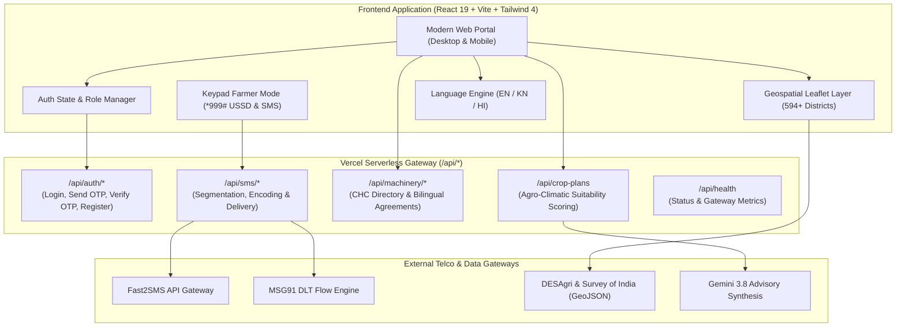

# AGRIFY — Agricultural Intelligence Network (India)

<div align="center">

[](LICENSE)
[](https://react.dev/)
[](https://www.typescriptlang.org/)
[](https://vitejs.dev/)
[](https://tailwindcss.com/)
[](https://agrify-app.vercel.app)
[](https://agrify-app.vercel.app)
[](https://agrify-app.vercel.app)

**A high-performance, full-stack decision-support platform designed to transform agricultural planning, machinery sharing, and agronomic intelligence across 594+ districts in India.**

[Explore Live Demo](https://agrify-app.vercel.app) · [Report Bug](.github/ISSUE_TEMPLATE/bug_report.md) · [Request Feature](.github/ISSUE_TEMPLATE/feature_request.md) · [Contributing Guide](CONTRIBUTING.md)

</div>

---

## 🌐 Live Production Deployments

AGRIFY is continuously deployed on Vercel with high-availability serverless functions and CDN edge caching:

| Environment | Production URL | Status |
| :--- | :--- | :--- |
| **Primary Production** | [https://agrify-app.vercel.app](https://agrify-app.vercel.app) |  |
| **National Mirror** | [https://agrify-india.vercel.app](https://agrify-india.vercel.app) |  |
| **Edge Preview** | [https://agrify-alpha.vercel.app](https://agrify-alpha.vercel.app) |  |

---

## 📖 Table of Contents

- [Overview](#-overview)
- [Core Features](#-core-features)
  - [1. Pan-India Geospatial Intelligence](#1-pan-india-geospatial-intelligence-594-districts)
  - [2. AI-Driven Crop Planning & Ranking](#2-ai-driven-crop-planning--ranking-engine)
  - [3. Custom Hiring Centre (CHC) & Machinery Agreements](#3-custom-hiring-centre-chc--bilingual-machinery-agreements)
  - [4. Keypad Farmer Mode & Live SMS/USSD Gateway](#4-keypad-farmer-mode--live-smsussd-telephony-gateway)
  - [5. Enterprise Authentication & Multi-Role System](#5-enterprise-authentication--multi-role-system)
  - [6. Global Dark Mode & Trilingual Localization](#6-global-dark-mode--trilingual-localization)
  - [7. Integrated Government Welfare Schemes](#7-integrated-government-welfare-schemes)
- [System Architecture](#-system-architecture)
- [Tech Stack](#-tech-stack)
- [Project Directory Structure](#-project-directory-structure)
- [Quick Start Guide](#-quick-start-guide)
- [Environment Variables](#-environment-variables)
- [Seeded Demo Accounts](#-seeded-demo-accounts)
- [API Reference](#-api-reference)
- [Scripts Reference](#-scripts-reference)
- [Contributing](#-contributing)
- [Security](#-security)
- [License & Acknowledgments](#-license--acknowledgments)

---

## 🌾 Overview

Indian agriculture faces significant systemic hurdles: climate volatility, fragmented landholdings, inaccessible machinery, and digital divides that isolate small and marginal farmers who rely on basic 2G/feature phones.

**AGRIFY** bridges this divide by delivering a unified, resilient, and inclusive digital infrastructure:
1. **For Tech-Connected Farmers & Agronomists**: A desktop and smartphone web portal offering geospatial climate maps, soil profile analysis, and multi-criteria AI crop ranking.
2. **For Rural Equipment Owners & CHCs**: A farm machinery marketplace that calculates hiring tariffs and automatically generates legal, bilingual (English + Kannada) rental contracts.
3. **For Keypad Feature-Phone Farmers**: A telephony-grade USSD (`*999#`) and SMS interface delivering the exact same agricultural insights without needing smartphones or mobile internet.

---

## 🚀 Core Features

### 1. Pan-India Geospatial Intelligence (594+ Districts)
- **Interactive Geospatial Boundaries**: Built on Leaflet and MapLibre with GPU-accelerated canvas layers rendering official Survey of India / DESAgri district polygons across all 28 states and 8 union territories.
- **Multilayer Thematic Overlays**:
  - **Precipitation Anomaly**: Live rainfall deficits vs 30-year IMD monsoon baselines.
  - **Soil Fertility Mapping**: Nitrogen, Phosphorus, Potassium (NPK), pH, and organic carbon levels across Red Sandy Loam, Black Cotton, Alluvial, and Laterite soils.
  - **Vegetative Vigor Index (NDRE / NDVI)**: Remote-sensing canopy health indicators for crop stress detection.
  - **Groundwater Extraction Levels**: Critical, semi-critical, and safe water table assessments.
- **District Intelligence Panel**: Instant contextual drawer for any clicked district showing local KVK contacts, primary crop clusters, rainfall status, and state subsidies.

### 2. AI-Driven Crop Planning & Ranking Engine
- **Agro-Climatic Multi-Criteria Decision Algorithm**:
  - Evaluates farm size, soil type, irrigation source (Canal, Borewell, Rainfed), previous season crop, and sowing window.
  - Generates a **Suitability Index (0–100%)** factoring Kharif, Rabi, and Zaid seasonal dynamics.
- **Economic Viability & Market Projection**:
  - Compares projected yield (Quintals/Acre) against official **MSP (Minimum Support Price)** benchmarks.
  - Outlines input expenditure (seeds, fertilizers, machinery labor) vs projected gross and net revenues.
- **Resilience Insights**: Flags high-risk crops during drought/delayed monsoons and suggests climate-hardy alternatives (e.g. Finger Millet / Ragi, Red Gram / Tur).

### 3. Custom Hiring Centre (CHC) & Bilingual Machinery Agreements
- **Mechanized Equipment Catalog**: Real-time availability for 45HP–75HP Tractors, Rotavators, Combine Harvesters, Laser Land Levelers, Multi-Crop Threshers, and Drone Sprayers.
- **Smart Tariff Calculator**: Estimates total rental costs based on acreage, operational hours, operator allowances, and diesel surcharges.
- **Legally Binding Rental Agreement (English + Kannada)**:
  - Formulated in accordance with the **Indian Contract Act 1872** and Sub-Mission on Agricultural Mechanization (SMAM) guidelines.
  - Contains complete operational terms: pre-use condition inspection, fuel protocols, breakdown liability, security deposit escrow, and local taluk jurisdiction.
  - Instant **Print to Stamp Paper / PDF Export** and persistent digital verification on the cloud.

### 4. Keypad Farmer Mode & Live SMS/USSD Telephony Gateway
- **True Feature-Phone Simulation**: Full keyboard-navigable physical keypad interface reproducing standard Nokia/Bharat-phone ergonomics.
- **8-Tier Interactive USSD Menu (`*999#`)**:
  ```text
  AGRIFY KISAN SEVA (*999#)
  1. Weather & Action Alert
  2. Crop Information
  3. Crop Planning (AI Rank)
  4. Farm Machinery (CHC)
  5. My Active Requests
  6. Government Schemes
  7. Change Language (EN/KN/HI)
  8. Help & USSD Codes
  ```
- **Telecom-Aware SMS Dispatcher**:
  - GSM-7 vs UTF-16 Unicode character length and encoding detection.
  - Automatic multipart message segmentation (`Menu (1/2)` and `Menu (2/2)`) preventing carrier truncation.
  - Dual-mode provider adapter supporting **Fast2SMS** (Quick SMS & DLT routes), **MSG91** flow templates, and offline simulation mode.

### 5. Enterprise Authentication & Multi-Role System
- **Dual Sign-In Experience**:
  - **Email & Password**: Show/hide password toggle, secure credential validation, and forgot password flow.
  - **Mobile OTP**: 10-digit Indian numbers (`+91`), 6 individual digit input boxes with auto-advance, backspace focus shifting, paste support, and 60-second resend countdown timer.
- **Stateless Serverless OTP Token Architecture**: Employs base64-encoded encrypted verification tokens ensuring reliable OTP validation across ephemeral serverless lambda instances without requiring external state stores.
- **Role-Based Access Control (RBAC)**:
  - 🌾 `farmer`: Landholding records, crop plans, machinery rental requests.
  - 🚜 `chc_operator`: Equipment inventory, tariff settings, agreement signing.
  - 🔬 `agri_analyst`: Geospatial datasets, climate anomaly feeds, yield models.
  - 🏛️ `gov_official`: Scheme disbursement metrics, district distress alerts.

### 6. Global Dark Mode & Trilingual Localization
- **Precision Dark Theme Palette**:
  - Primary Background: `#101713`
  - Cards & Modals: `#18231C`
  - Secondary Elevated: `#202D24`
  - Structural Borders: `#34443A`
  - Emerald Accents: `#16A36A`
  - Pale Highlighting: `#244C37`
  - High-Contrast Text: `#F3F7F3` / Secondary Text: `#AAB8AE`
- **Full Trilingual Localization**:
  - **English** (`en`)
  - **Kannada** (`kn` — ಕನ್ನಡ): Full vernacular translation including machinery legal terms, crop varieties (ರಾಗಿ, ತೊಗರಿ), and keypad alerts.
  - **Hindi** (`hi` — हिंदी): Agricultural terms, scheme descriptions, and USSD prompts.

### 7. Integrated Government Welfare Schemes
- Direct eligibility checkers and guidelines for national and state welfare programs:
  - **PM-KISAN**: ₹6,000/year direct income support installment tracking.
  - **PMFBY**: Pradhan Mantri Fasal Bima Yojana crop insurance claim thresholds.
  - **Raitha Siri (Karnataka)**: ₹10,000/ha incentive for minor millet cultivation.
  - **SMAM**: Sub-Mission on Agricultural Mechanization up to 50% subsidy on equipment purchase.
  - **Soil Health Card Scheme**: Micronutrient testing schedules and fertilizer optimization.

---

## 🏛️ System Architecture



---

## 💻 Tech Stack

| Layer | Technologies |
| :--- | :--- |
| **Frontend Framework** | [React 19](https://react.dev/) with React DOM 19 |
| **Language & Tooling** | [TypeScript 5.8](https://www.typescriptlang.org/), [Vite 8.3](https://vitejs.dev/), [Oxlint](https://oxc.rs/) |
| **Styling & Design System** | [Tailwind CSS v4](https://tailwindcss.com/) with native CSS variables and dark-mode tokens |
| **Geospatial & Visualizations** | [Leaflet 1.9](https://leafletjs.com/), [Recharts 3.10](https://recharts.org/), Custom GeoJSON boundary processing |
| **Icons & UI Utilities** | [Lucide React](https://lucide.dev/), `clsx`, `tailwind-merge` |
| **Backend & Serverless API** | Node.js ESM serverless handlers running on [Vercel](https://vercel.com/) |
| **Telephony & SMS Integration** | Fast2SMS Quick/DLT API, MSG91 Flow, GSM-7 / Unicode SMS multi-part encoder |
| **Internationalization** | In-house zero-overhead type-safe dictionary engine (`en`, `kn`, `hi`) |

---

## 📁 Project Directory Structure

```text
agrify/
├── .github/
│   ├── workflows/
│   │   └── ci.yml                     # GitHub Actions CI workflow (lint, typecheck, build)
│   ├── ISSUE_TEMPLATE/
│   │   ├── bug_report.md              # Structured bug report template
│   │   └── feature_request.md         # Structured feature request template
│   └── PULL_REQUEST_TEMPLATE.md       # PR checklist and verification template
├── api/                               # Vercel Serverless Function Handlers
│   ├── auth/
│   │   ├── login-email.js             # Email & password authentication
│   │   ├── send-otp.js                # Telco SMS OTP dispatch
│   │   ├── verify-otp.js              # Stateless OTP verification
│   │   ├── register.js                # New user registration
│   │   └── forgot-password.js         # Password reset flow
│   ├── machinery/
│   │   └── agreements.js              # Bilingual machinery contract storage
│   ├── sms/
│   │   ├── send.js                    # SMS dispatch endpoint
│   │   ├── history.js                 # Message audit log
│   │   ├── status.js                  # Delivery status inquiry
│   │   └── provider-status.js         # Gateway health & route telemetry
│   ├── index.js                       # Root serverless router & AI agronomy handler
│   └── [...slug].js                   # Catch-all serverless dispatcher
├── public/
│   ├── data/
│   │   └── india_districts.geojson    # 594+ Indian district boundary geometries
│   └── favicon.svg                    # AGRIFY brand icon
├── src/
│   ├── components/
│   │   ├── auth/                      # Login cards, OTP digit boxes, modal wrappers
│   │   ├── common/                    # Global navigation, dark mode toggle, mobile drawers
│   │   ├── crops/                     # AI farm advisor, crop planning cards
│   │   ├── farmer/                    # Farmer dashboard, KPI summaries
│   │   ├── geospatial/                # Leaflet map container, district drawers, thematic legends
│   │   ├── keypad/                    # Physical keypad simulator, USSD dialer, SMS monitor
│   │   └── machinery/                 # CHC catalog, tariff calculator, bilingual agreement modal
│   ├── context/
│   │   ├── AuthContext.tsx            # Reactive user session & role provider
│   │   ├── LanguageContext.tsx        # Trilingual localization context
│   │   └── ThemeContext.tsx           # Dark/Light mode provider with localStorage persistence
│   ├── locales/
│   │   ├── en.ts                      # English strings
│   │   ├── kn.ts                      # Kannada (ಕನ್ನಡ) strings
│   │   └── hi.ts                      # Hindi (हिंदी) strings
│   ├── pages/
│   │   ├── HomePage.tsx               # Main portal with interactive hero & quick actions
│   │   ├── GeospatialPage.tsx         # Fullscreen district intelligence map
│   │   ├── CropPlannerPage.tsx        # AI suitability ranking & economic calculator
│   │   ├── MachineryPage.tsx          # CHC directory & legal agreement builder
│   │   ├── KeypadModePage.tsx         # Accessible *999# feature phone simulator
│   │   └── LoginPage.tsx              # Two-column desktop & responsive mobile login
│   ├── server/
│   │   └── viteApiPlugin.ts           # Development API mock & SMS gateway plugin
│   ├── services/
│   │   ├── authClient.ts              # Client auth API caller & session caching
│   │   └── smsClient.ts               # SMS calculation, GSM-7 segmentation & transmission
│   ├── types/
│   │   ├── auth.ts                    # User, Session, and Role TypeScript interfaces
│   │   └── ...                        # Crop, Machinery, and Geospatial domain types
│   ├── App.tsx                        # Router layout and modal providers
│   ├── index.css                      # Tailwind v4 configuration & theme tokens
│   └── main.tsx                       # React application entrypoint
├── .env.example                       # Documented environment variables template
├── .gitignore                         # Git exclusion rules (ignores secrets & artifacts)
├── CONTRIBUTING.md                    # Guidelines for open-source contributors
├── LICENSE                            # MIT License
├── package.json                       # Scripts, dependencies, and project metadata
├── README.md                          # Master documentation
├── SECURITY.md                        # Security vulnerability disclosure policy
├── tsconfig.json                      # TypeScript configuration
└── vercel.json                        # Vercel deployment rewrites & build settings
```

---

## ⚡ Quick Start Guide

### Prerequisites
- **Node.js**: `v18.0.0` or higher (`v20.x` or `v22.x` recommended)
- **npm**: `v9.0.0` or higher
- **Git**

### Installation

1. **Clone the repository**:
   ```bash
   git clone https://github.com/YOUR_USERNAME/agrify.git
   cd agrify
   ```

2. **Install dependencies**:
   ```bash
   npm install
   ```

3. **Configure environment variables**:
   ```bash
   cp .env.example .env
   ```
   *(The default `.env.example` is fully operational in `simulation` mode—no external API keys required to start).*

4. **Launch the development server**:
   ```bash
   npm run dev
   ```
   Navigate to [http://localhost:5173](http://localhost:5173) in your browser.

5. **Verify production build**:
   ```bash
   npm run build
   ```

---

## 🔑 Environment Variables

Configure these settings in your `.env` or deployment dashboard (e.g. Vercel Project Settings):

| Variable | Default Value | Description |
| :--- | :--- | :--- |
| `SMS_MODE` | `simulation` | Set to `production` for real telco SMS delivery via Fast2SMS/MSG91. |
| `SMS_PROVIDER` | `fast2sms` | Telco adapter: `fast2sms` or `msg91`. |
| `FAST2SMS_API_KEY` | *Optional* | Your Fast2SMS Authorization Key from [fast2sms.com](https://www.fast2sms.com/). |
| `FAST2SMS_ROUTE` | `q` | `q` for Quick SMS (instant tests); `dlt` for Enterprise DLT-approved templates. |
| `FAST2SMS_SENDER_ID` | `FSTSMS` | 6-character sender ID registered on the Indian DLT portal. |
| `MSG91_AUTH_KEY` | *Optional* | Your MSG91 Authkey from [msg91.com](https://msg91.com/). |
| `USSD_API_KEY` | *Optional* | Shared secret for telecom operator USSD webhooks. |
| `USSD_SERVICE_CODE`| `*999#` | Default USSD service code assigned by telco. |
| `GEMINI_API_KEY` | *Optional* | Google Gemini API key for agronomic explanations and advisory synthesis. |
| `AUTH_JWT_SECRET` | *Configured* | Secret token for signing client session tokens. |
| `AUTH_OTP_EXPIRY_SECONDS` | `300` | OTP validity window in seconds (5 minutes). |

---

## 👤 Seeded Demo Accounts

To test role-based access immediately without creating a new user, use any of the seeded demo accounts:

| Role | Email | Password | Phone Number | Demo OTP |
| :--- | :--- | :--- | :--- | :--- |
| **Farmer** | `farmer@agrify.in` | `Agrify@2026` | `+91 98450 11223` | `123456` |
| **Agri Analyst** | `analyst@agrify.in` | `Agrify@2026` | `+91 98800 99881` | `123456` |
| **CHC Operator** | `chc@agrify.in` | `Agrify@2026` | `+91 94480 23456` | `123456` |

> [!NOTE]
> When testing Mobile OTP sign-in, the system returns a simulated OTP in development/preview mode. You can also enter the universal master demo code **`123456`** to verify any phone number instantly.

---

## 📡 API Reference

All endpoints are hosted as serverless functions under `/api`:

| Method | Endpoint | Description | Sample Payload / Params |
| :--- | :--- | :--- | :--- |
| `GET` | `/api/health` | Health check and system uptime | `None` |
| `POST` | `/api/auth/login-email` | Authenticate using email & password | `{"email": "farmer@agrify.in", "password": "..."}` |
| `POST` | `/api/auth/send-otp` | Dispatch 6-digit OTP to mobile | `{"phone": "9845011223"}` |
| `POST` | `/api/auth/verify-otp` | Verify OTP code & return session token | `{"phone": "9845011223", "otp": "123456"}` |
| `POST` | `/api/auth/register` | Register new user profile | `{"name": "...", "phone": "...", "role": "farmer"}` |
| `GET` | `/api/crop-plans` | Retrieve saved crop plans | `None` |
| `POST` | `/api/crop-plans` | Save newly generated AI crop plan | `{"planName": "...", "farmProfile": {...}}` |
| `GET` | `/api/machinery/agreements` | Query signed machinery rental contracts | `?bookingId=BK-884` |
| `POST` | `/api/machinery/agreements` | Store signed bilingual agreement | `{"agreementId": "...", "farmerName": "..."}` |
| `POST` | `/api/sms/send` | Transmit single or multipart SMS | `{"recipient": "9845011223", "message": "..."}` |
| `GET` | `/api/sms/provider-status`| Get telco SMS gateway operational status | `None` |

---

## 🛠️ Scripts Reference

| Command | Action |
| :--- | :--- |
| `npm run dev` | Starts Vite local development server with HMR at `http://localhost:5173` |
| `npm run build` | Compiles TypeScript (`tsc -b`) and bundles production assets via Vite |
| `npm run lint` | Runs ultra-fast Oxlint checks across all files |
| `npm run preview` | Locally serves the production `dist/` build for smoke testing |

---

## 🤝 Contributing

Contributions make the open-source community an amazing place to learn, inspire, and create. We welcome contributions from developers, agronomists, and translators worldwide!

Please review our [Contributing Guide](CONTRIBUTING.md) for full details on our code of conduct, development setup, and pull request workflow.

```bash
# 1. Create a feature branch
git checkout -b feat/my-new-feature

# 2. Commit your changes
git commit -m "feat: add soil moisture indicator to district panel"

# 3. Push branch and open a PR
git push origin feat/my-new-feature
```

---

## 🔒 Security

For security vulnerability disclosures, please review our [Security Policy](SECURITY.md). Do not disclose security issues on public issue trackers.

---

## 📄 License & Acknowledgments

Distributed under the **MIT License**. See [`LICENSE`](LICENSE) for full details.

### Acknowledgments & Data Sources
- **ICAR (Indian Council of Agricultural Research)**: Package of Practices and crop physiology standards.
- **DESAgri (Directorate of Economics & Statistics)**: Minimum Support Price (MSP) and historical yield data.
- **IMD (India Meteorological Department)**: Agro-meteorological rainfall baselines and climate indices.
- **Survey of India & OpenStreetMap**: Geographic district boundary datasets.
- **Fast2SMS & MSG91**: Telephony infrastructure support for rural farmer connectivity.

---

<div align="center">

**Built with pride for Indian Farmers & Agriculture · ಭಾರತದ ಕೃಷಿಕರ ಉನ್ನತಿಗಾಗಿ**

[⬆ Back to Top](#agrify--agricultural-intelligence-network-india)

</div>
